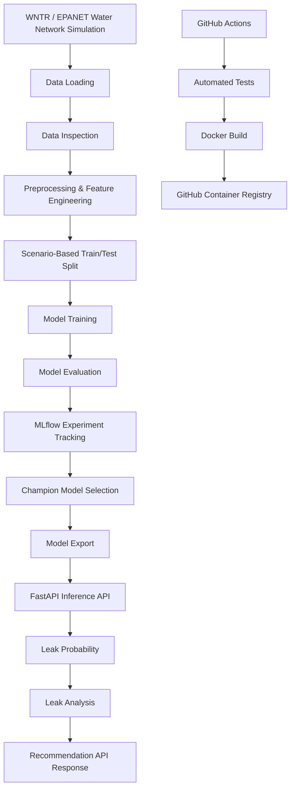
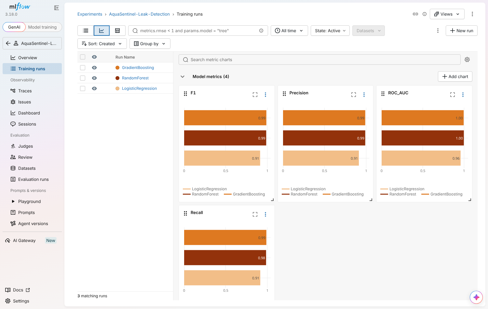
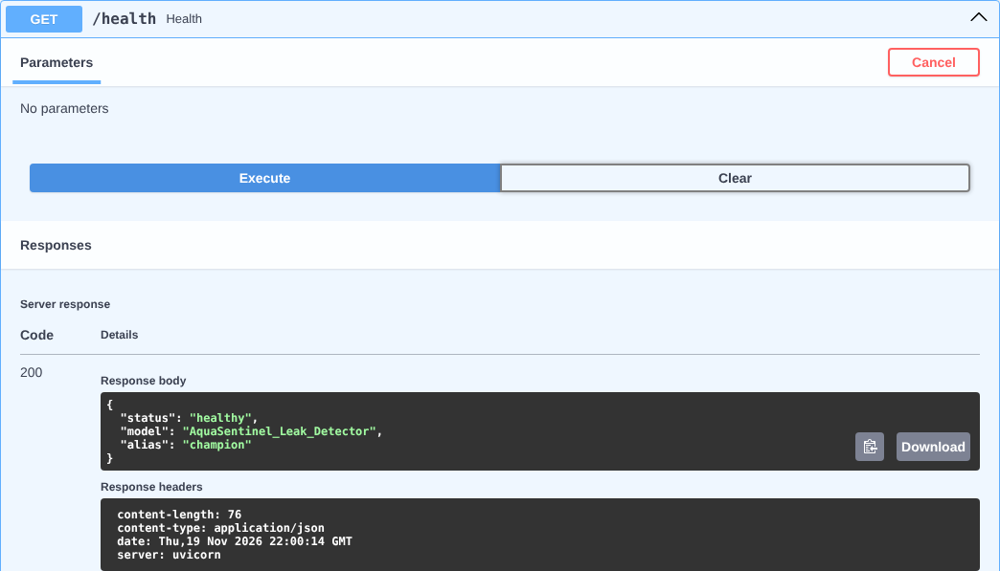
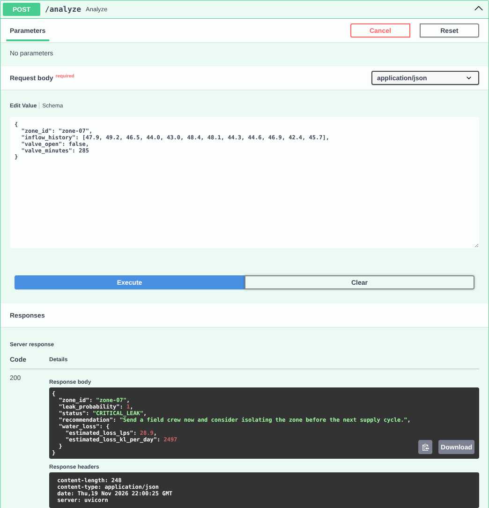
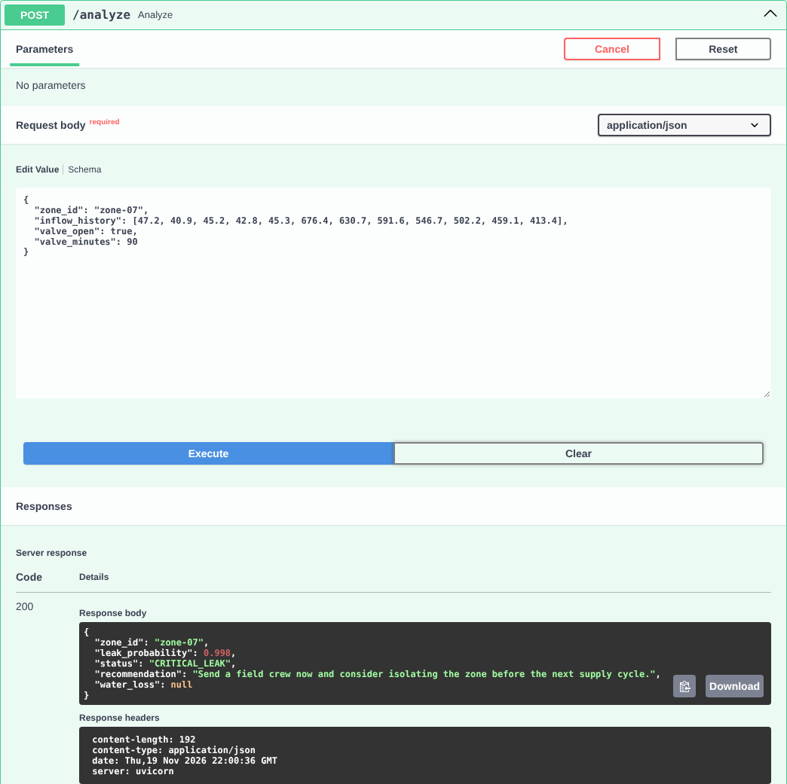
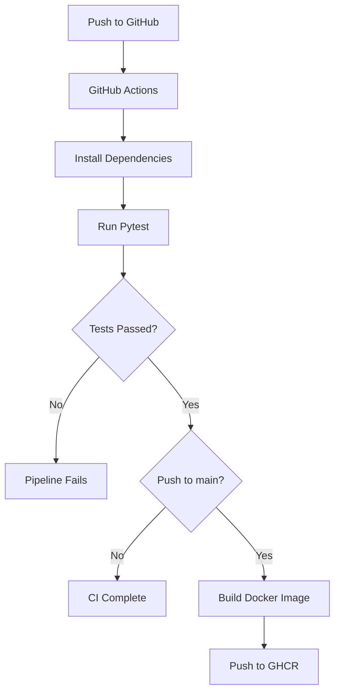

# AquaSentinel — AI Leak Detection for Water Pipelines

A machine learning-powered leak detection system for city water supply zones that run on intermittent supply, as most Indian cities do.

AquaSentinel watches the total water flowing into a supply zone and detects when the inflow pattern looks like a leak. It combines water network simulation, machine learning, experiment tracking, API development, containerization, and automated CI/CD into a single end-to-end project.

---

## Overview

Indian cities lose a large share of treated water before it reaches consumers. Much of it leaks out of underground pipes, and most leaks are only found when water appears on the surface.

Most cities also supply water for only a few hours a day. When the supply valve opens, households fill their sumps and overhead tanks, so the inflow jumps and varies a lot from day to day. When the valve is closed, very little water should flow. A leak keeps drawing water all the time, so it shows up most clearly while supply is off.

AquaSentinel aims to address this problem by:

- Simulating a city supply zone with intermittent supply and random leaks.
- Learning the difference between normal inflow and leak inflow from historical readings.
- Classifying the current state of a zone as leak or no leak.
- Estimating how much water is being lost.
- Providing actionable recommendations for the water utility.
- Exposing predictions through a REST API.
- Tracking machine learning experiments and models using MLflow.
- Containerizing the application using Docker.
- Automating testing and container publishing through GitHub Actions.

---

## Project Objectives

- Build an end-to-end machine learning pipeline.
- Simulate realistic water network data with WNTR (EPANET).
- Perform time-series feature engineering on zone inflow data.
- Train and compare multiple classification models.
- Evaluate models using appropriate classification metrics.
- Track experiments and manage models using MLflow.
- Serve predictions using FastAPI.
- Develop a rule-based leak response recommendation system.
- Dockerize the application.
- Implement automated testing and CI/CD using GitHub Actions.
- Publish Docker images to GitHub Container Registry (GHCR).

---

## System Architecture



---

## Machine Learning Pipeline

### Step 1 — Data Collection

Sensor data from Indian water utilities is not publicly available, so the project simulates it using **WNTR** (Water Network Tool for Resilience), the US EPA's Python package built on the EPANET hydraulic engine.

The EPANET example network **Net3** is used as one supply zone. It has 97 junctions, 2 water sources and 3 service reservoirs. The flow leaving each source and reservoir is measured, and their sum is the total water entering the zone:

`inflow = water used by households + water lost to leaks`

The simulation follows how water is supplied in most Indian cities:

| Feature of Indian supply | How it is simulated |
|---|---|
| Water only for a few hours a day | Supply valve open 5–8 am and 5–7 pm |
| Supply timings slip | Start time shifts by up to 45 minutes each day |
| Households fill sumps and overhead tanks | Demand is 3× normal when supply starts and falls to 1.6× as tanks fill |
| Different amounts each supply | ±15% per supply window |
| Very little use while supply is off | 8% of normal demand |

In leak scenarios, a leak of random size is added at a random junction on day 2, and every reading after the leak starts is labelled `leak = 1`.

**Dataset characteristics:**

| Property | Value |
|---|---|
| Data source | WNTR simulation of EPANET Net3 |
| Scenarios (zones) | 36 (12 normal, 24 with a leak) |
| Records | 6,948 |
| Readings per scenario | 193 (2 days) |
| Sampling interval | 15 minutes |
| Leak hole sizes | 0.0005 – 0.003 m² |
| Target variable | `leak` (0 = no leak, 1 = leak) |

The processed dataset is saved as `data/processed/zone_inflow.csv`.

---

### Step 2 — Data Inspection

Before training, the dataset is inspected to understand:

- Dataset structure and column types.
- Number of normal and leak scenarios.
- Missing or invalid values.
- Timestamp intervals.
- Inflow with and without leaks, while supply is on and off.

The inspection shows why supply status matters:

| Inflow (L/s) | Supply off | Supply on |
|---|---:|---:|
| No leak (average) | 15.6 | 441.2 |
| With a leak (average) | 55.0 | 471.7 |

While supply is on, a leak adds only a few percent to a large, variable inflow. While supply is off, it more than triples the inflow.

---

### Step 3 — Preprocessing & Feature Engineering

Instead of classifying a reading using only the current inflow, AquaSentinel uses the last 3 hours of readings and the supply valve status.

The target variable is:

`leak`

The following features are generated:

| Feature | Description |
|---|---|
| `inflow_lps` | Total inflow into the zone right now (L/s) |
| `valve_open` | 1 if the supply valve is open, 0 if closed |
| `valve_minutes` | Minutes since the valve last opened or closed |
| `inflow_mean_4` | Average inflow over the last hour (4 readings) |
| `inflow_mean_12` | Average inflow over the last 3 hours (12 readings) |
| `inflow_min_12` | Lowest inflow in the last 3 hours |
| `inflow_change_4` | Change in inflow compared with one hour ago |

`inflow_min_12` is the most useful feature. It is the same idea water utilities use in minimum night flow analysis: when nobody is using water, the remaining flow is mostly leakage.

The features only use the current and earlier readings, never future readings. Since the data is grouped by scenario, the features are generated independently for each scenario.

---

### Step 4 — Train/Test Split

The dataset is split by scenario: 70% of the scenarios are used for training and 30% for testing.

Normal and leak scenarios are split separately so that both kinds appear in the test set.

A random split of individual readings is avoided. Readings from the same scenario are very similar, so a random split would put almost identical readings in both sets and make the results look better than they are. Splitting by scenario tests the model on zones it has never seen.

| Split | Scenarios | Rows | Leak share |
|---|---:|---:|---:|
| Train | 25 | 4,550 | 46.1% |
| Test | 11 | 2,002 | 47.3% |

---

### Step 5 — Model Training

Three classification models were trained and compared:

1. Logistic Regression
2. Random Forest Classifier
3. Gradient Boosting Classifier

#### Logistic Regression

Used as a baseline model. The features are standardised first, and the model learns a straight-line boundary between leak and no-leak readings.

#### Random Forest Classifier

Uses many decision trees to capture non-linear relationships, for example "high inflow is normal right after the valve opens, but not three hours after it closes".

#### Gradient Boosting Classifier

Builds trees one after another, each one trying to fix the mistakes of the previous trees.

The models were trained using the same engineered features and evaluated on the same test scenarios.

---

### Step 6 — Model Evaluation

The models were evaluated using four classification metrics.

| Metric | Purpose |
|---|---|
| Precision | Of the readings flagged as leaks, how many really were leaks (few false alarms) |
| Recall | Of the real leak readings, how many were found (few missed leaks) |
| F1 Score | Balance of precision and recall |
| ROC AUC | How well the model ranks leak readings above normal ones, at any threshold |

#### Model Comparison

| Model | Precision | Recall | F1 | ROC AUC |
|---|---:|---:|---:|---:|
| Logistic Regression | 0.9116 | 0.9145 | 0.9130 | 0.9582 |
| Random Forest | 0.9883 | 0.9842 | 0.9862 | **0.9975** |
| Gradient Boosting | **0.9884** | **0.9873** | **0.9878** | 0.9957 |

Gradient Boosting achieved the best F1 score, with the highest precision and recall among the three models.

Therefore, Gradient Boosting was selected as the champion model.

The scores are high because the simulated leaks are clearly visible while supply is off. Real data would be noisier (see Limitations).

---

### Step 7 — Experiment Tracking with MLflow

MLflow was used to track machine learning experiments and manage the trained model.

The project uses MLflow for:

- Experiment tracking.
- Logging model parameters and evaluation metrics.
- Comparing trained models.
- Recording model artifacts with input signatures.
- Model registration.
- Champion model management through aliases.

The trained model is registered as:

`AquaSentinel_Leak_Detector`

The selected model version is assigned the alias:

`champion`

This provides a clear reference to the model selected for inference rather than hardcoding a particular model version throughout the application.

#### MLflow Dashboard

The MLflow dashboard allows experiments and model performance to be compared visually.



---

### Step 8 — Champion Model Export

Once the champion model is selected, it is exported as a standalone model artifact:

`models/champion.joblib`

This allows the inference application to load the model directly without depending on the MLflow tracking server during API execution.

MLflow is used during experimentation and model selection, while the exported model artifact is used for inference.

This separation makes the application easier to package and deploy.

---

## Leak Detection & Analysis Logic

### Step 9 — Leak Prediction

The API receives the recent inflow history of a zone and the current supply valve status.

The inference pipeline:

1. Validates the inflow history.
2. Extracts the required features from the last 12 readings.
3. Constructs the feature DataFrame in the same order used during training.
4. Loads the champion model artifact.
5. Predicts the probability that the zone has a leak.

The API returns the leak probability for the requested zone.

---

### Step 10 — Leak Analysis

After predicting the leak probability, AquaSentinel evaluates it using a rule-based recommendation engine.

| Leak probability | Status | Recommendation |
|---|---|---|
| Below 0.30 | NO_LEAK | No action is required |
| 0.30 to below 0.60 | WATCH | Check again during the next off-supply period |
| 0.60 to below 0.85 | LIKELY_LEAK | Schedule a leak survey (acoustic listening) within 48 hours |
| 0.85 and above | CRITICAL_LEAK | Send a field crew now and consider isolating the zone |

While supply is off, the engine also estimates the water being lost:

`estimated loss = recent inflow − normal off-supply inflow (16 L/s)`

and converts it to kilolitres per day (`L/s × 86.4`). During supply hours this estimate is not given, because households filling their tanks hide the extra flow.

These thresholds are configurable project-level decision rules, not official water utility standards.

---

## REST API — FastAPI

AquaSentinel exposes its prediction and analysis functionality through a REST API built using FastAPI.

The API allows a SCADA system or a monitoring dashboard to send recent inflow readings and receive a leak prediction or a recommendation.

### Available Endpoints

| Method | Endpoint | Description |
|---|---|---|
| GET | `/` | Returns API information |
| GET | `/health` | Health endpoint |
| POST | `/predict` | Predicts the leak probability |
| POST | `/analyze` | Predicts the leak probability and generates a recommendation |

---

### 1. Root Endpoint

**Endpoint:**

`GET /`

Returns basic API information.

---

### 2. Health Endpoint

**Endpoint:**

`GET /health`

Used to check whether the API is responding.



---

### 3. Leak Prediction Endpoint

**Endpoint:**

`POST /predict`

Accepts a zone identifier, its last 12 or more inflow readings (L/s, oldest first) and the current valve status.

#### Request

```json
{
  "zone_id": "zone-07",
  "inflow_history": [
    47.9, 49.2, 46.5, 44.0,
    43.0, 48.4, 48.1, 44.3,
    44.6, 46.9, 42.4, 45.7
  ],
  "valve_open": false,
  "valve_minutes": 285
}
```

Supply has been off for 285 minutes, but about 46 L/s is still flowing into the zone, roughly three times the normal off-supply inflow.


---

### 4. Leak Analysis Endpoint

**Endpoint:**

`POST /analyze`

This endpoint combines the model and the leak analysis rules.

It:

1. Accepts the recent inflow history and valve status.
2. Predicts the leak probability.
3. Evaluates the probability against the analysis thresholds.
4. Returns the status, recommendation and estimated water loss.

#### Request

```json
{
  "zone_id": "zone-07",
  "inflow_history": [
    47.9, 49.2, 46.5, 44.0,
    43.0, 48.4, 48.1, 44.3,
    44.6, 46.9, 42.4, 45.7
  ],
  "valve_open": false,
  "valve_minutes": 285
}
```



---

### No Leak Scenario

The same zone without a leak: about 17 L/s while supply is off, which is normal.


---

### Leak During Supply Hours

A leaking zone just after supply started. The model still detects the leak from the inflow before the valve opened, but no water loss estimate is given while households are filling their tanks.



---

### API Validation

The API includes input validation to prevent invalid requests from reaching the prediction pipeline.

Validation includes:

- At least 12 inflow readings (3 hours) are required for feature generation.
- Inflow values must be between 0 and 5000 L/s.
- `valve_minutes` cannot be negative.
- Invalid requests are rejected with HTTP 422 validation errors.

#### Invalid Input Test


---

## Project Structure

```text
AquaSentinel/
│
├── .github/
│   └── workflows/
│       └── ci.yml
│
├── data/
│   ├── raw/
│   └── processed/
│       └── zone_inflow.csv
│
├── image/
│   ├── analyze.png
│   ├── health.png
│   ├── invalid.png
│   ├── mlflow.png
│   ├── noleak.png
│   ├── predict.png
│   └── supply.png
│
├── models/
│   └── champion.joblib
│
├── src/
│   ├── __init__.py
│   ├── api.py
│   ├── data_loader.py
│   ├── inspect_data.py
│   ├── inference.py
│   ├── leak_analysis.py
│   └── preprocessing.py
│
├── tests/
│   └── test_api.py
│
├── Dockerfile
├── .dockerignore
├── .gitignore
├── commands.txt
├── main.py
├── train.py
├── requirements.txt
└── README.md
```

---

## Tech Stack

| Technology | Purpose |
|---|---|
| Python 3.12 | Primary programming language |
| WNTR (EPANET) | Water network simulation |
| Pandas | Data manipulation and feature engineering |
| NumPy | Numerical computations |
| Scikit-learn | Model training and evaluation |
| MLflow | Experiment tracking and model registry |
| Joblib | Model serialization |
| FastAPI | REST API development |
| Pydantic | Request validation |
| Pytest | Automated testing |
| HTTPX | API testing |
| Docker | Application containerization |
| GitHub Actions | CI/CD automation |
| GitHub Container Registry | Docker image storage |

---

## Running the Project Locally

### Step 1 — Clone the Repository

```bash
git clone https://github.com/Shikhar0305/AquaSentinel.git
cd AquaSentinel
```

### Step 2 — Create a Virtual Environment

```bash
python -m venv venv
```

Activate it on Windows:

```bash
venv\Scripts\activate
```

Activate it on Linux/macOS:

```bash
source venv/bin/activate
```

### Step 3 — Install Dependencies

```bash
pip install -r requirements.txt
```

### Step 4 — Run the Training Pipeline (optional)

The trained champion model is already included in `models/champion.joblib`. To simulate the data and retrain the models yourself:

```bash
python main.py
```

The first run simulates the water network, which takes about 1–2 minutes.

### Step 5 — Run the API

```bash
uvicorn src.api:app --reload
```

The API will be available at:

`http://127.0.0.1:8000`

### Step 6 — Explore API Documentation

FastAPI automatically generates interactive API documentation.

Swagger UI:

`http://127.0.0.1:8000/docs`

Alternative documentation:

`http://127.0.0.1:8000/redoc`

You can directly execute API requests through Swagger UI.

---

## Running MLflow

To view MLflow experiments, run (after `python main.py`):

```bash
mlflow ui --backend-store-uri sqlite:///mlflow.db --port 5000
```

Open:

`http://127.0.0.1:5000`

The dashboard allows you to compare model metrics, review experiments, and inspect registered models.

---

## Docker

AquaSentinel is containerized using Docker to provide a consistent runtime environment.

### Build the Docker Image

```bash
docker build -t aquasentinel .
```

### Run the Container

```bash
docker run -p 8000:8000 aquasentinel
```

The API will be accessible at:

`http://localhost:8000`

Swagger documentation:

`http://localhost:8000/docs`

Docker packages the API, its dependencies, and the exported champion model into a portable container image.

The CI/CD pipeline also publishes the image, so it can be pulled directly:

```bash
docker pull ghcr.io/shikhar0305/aquasentinel:latest
```

---

## Automated Testing

The project uses Pytest and FastAPI TestClient to test API functionality.

Tests cover:

- Root endpoint.
- Health endpoint.
- Leak prediction endpoint.
- No-leak analysis.
- Critical leak analysis with water loss estimate.
- The real champion model separating a leak from a normal zone.
- No water loss estimate during supply hours.
- Too short inflow history.
- Inflow values outside the valid range.

Run the tests using:

```bash
python -m pytest tests/ -v
```

Automated tests help detect regressions before the application is packaged and published.

---

## CI/CD Pipeline — GitHub Actions

GitHub Actions automates the testing and container publishing workflow.

The pipeline is triggered by:

- Pushes to `main`.
- Pull requests targeting `main`.
- Manual workflow execution.

### CI — Continuous Integration

The test job:

1. Checks out the repository.
2. Sets up Python 3.12.
3. Installs project dependencies.
4. Executes the automated test suite.

If tests fail, the subsequent build-and-publish job is not executed.

### CD — Build & Publish

After the test job succeeds, pushes to `main` trigger the publishing job.

The publishing job:

1. Checks out the repository.
2. Sets up Docker Buildx.
3. Authenticates with GitHub Container Registry.
4. Generates Docker image tags.
5. Builds the Docker image.
6. Pushes the image to GHCR.

The workflow publishes images with:

- `latest` — latest published version.
- Commit SHA tag — identifies a specific source-code revision.

### Pipeline Flow



This pipeline ensures that the application is tested before its container image is published.

---

## Key Engineering Decisions

### 1. Simulated Data with Indian Supply Patterns

Real utility data is not public, so the zone is simulated with WNTR using intermittent supply, slipping supply timings and household tank filling, which are typical of Indian cities.

### 2. Water Balance as the Main Signal

All features are built from the total inflow into the zone. Inflow = consumption + leaks, so a leak always shows up as extra inflow.

### 3. Supply Status as a Feature

The valve status and minutes since the valve switched tell the model which part of the supply cycle a reading belongs to. Without them, the large inflow during tank filling would look like a leak.

### 4. Scenario-Based Data Splitting

Whole scenarios go to either training or testing, so the model is evaluated on zones it has never seen.

### 5. Model Comparison

Multiple classification models were evaluated rather than relying on one algorithm without comparison. The champion was selected based on test-set F1 score.

### 6. MLflow for Experiment Tracking

MLflow separates experimentation, metric comparison, and model registration from the inference application.

### 7. Standalone Model Artifact

The champion model is exported as a Joblib artifact so the inference API can load it without requiring the MLflow tracking environment at runtime.

### 8. FastAPI

FastAPI provides lightweight REST endpoints, request validation, and automatically generated API documentation.

### 9. Docker

Containerization ensures that the API and its runtime dependencies can be packaged and executed consistently across environments.

### 10. CI/CD

GitHub Actions automates testing and container publishing, reducing the need for manually validating and building every release.

---

## Limitations

- The data is simulated on the EPANET Net3 network, not measured in an Indian city.
- WNTR cannot simulate pipes emptying between supplies, so the mains are assumed to stay full of water.
- Only one leak at a time, and leaks never stop by themselves.
- The model needs a flow meter on every inlet to the zone and a record of when the supply valve opens and closes.
- A leak and an illegal connection both look like extra inflow.

## Author

**Shikhar0305**
