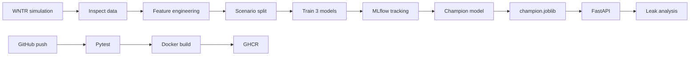
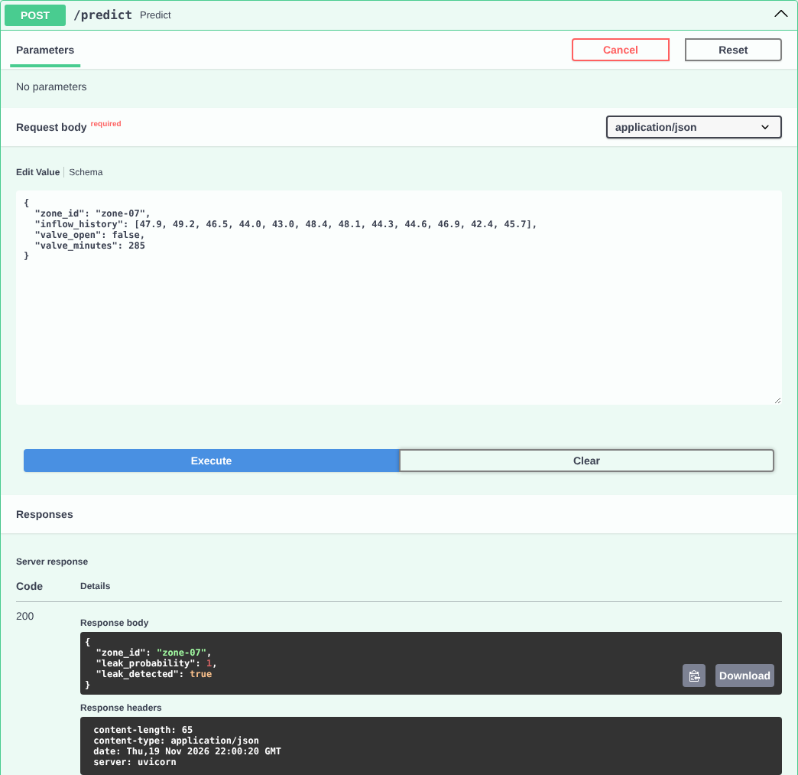
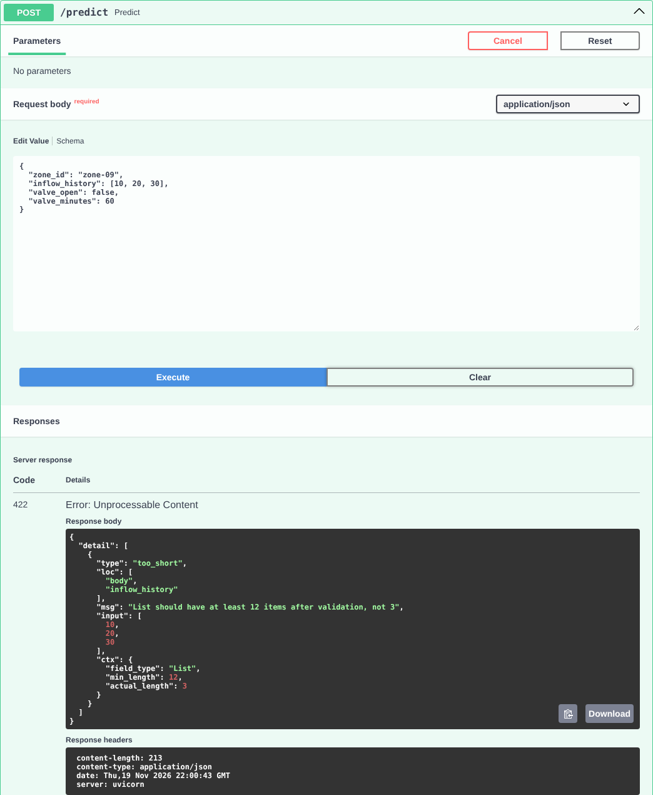
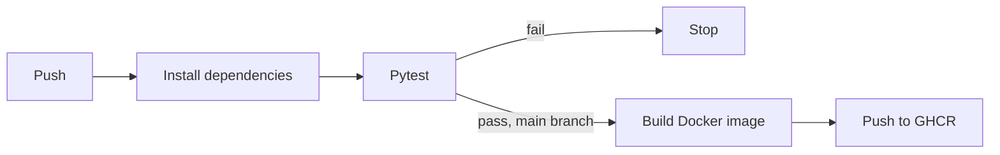

# AquaSentinel — AI Leak Detection for Water Pipelines

An end-to-end MLOps project that detects leaks in a city water supply zone from inflow sensor data. It covers the full pipeline: data simulation, feature engineering, model training and comparison, experiment tracking with MLflow, a FastAPI service, Docker, and CI/CD with GitHub Actions.

---

## Problem

In many Indian cities 40–65% of treated water never earns revenue (leaks, theft and unmetered use). Underground leaks are a big part of it and are usually noticed only when water reaches the surface.

Most cities also supply water for only a few hours a day:

- **Supply on:** households fill sumps and overhead tanks, so inflow is very high and varies a lot. A leak is hard to spot.
- **Supply off:** almost no water should flow. A leak keeps drawing water, so it stands out clearly.

AquaSentinel uses this pattern to detect leaks from the total inflow into a zone.

---

## Architecture



---

## 1. Data

Real utility data is not public, so a supply zone is simulated with **WNTR** (the US EPA's EPANET-based water network simulator) on the **Net3** network: 97 junctions, 2 sources, 3 service reservoirs.

**Water balance:** total inflow into the zone = water used + water leaked.

| Indian supply pattern | Simulation |
|---|---|
| Water a few hours a day | Valve open 5–8 am and 5–7 pm |
| Supply timings slip | Start shifts up to ±45 minutes |
| Households fill storage tanks | Demand 3× at supply start, falling to 1.6× |
| Little use when supply is off | 8% of normal demand |

| Property | Value |
|---|---|
| Scenarios | 36 (12 normal, 24 with one leak) |
| Records | 6,948 (193 per scenario, every 15 min) |
| Leak hole size | 0.0005 – 0.003 m² |
| Target | `leak` (0 / 1) |

Average inflow found during inspection:

| Inflow (L/s) | Supply off | Supply on |
|---|---:|---:|
| No leak | 15.6 | 441.2 |
| Leak | 55.0 | 471.7 |

---

## 2. Features

Built from the last 3 hours (12 readings) of each scenario, using only past and current readings:

| Feature | Meaning |
|---|---|
| `inflow_lps` | Current inflow (L/s) |
| `valve_open` | Supply valve open (1) or closed (0) |
| `valve_minutes` | Minutes since the valve last switched |
| `inflow_mean_4` | Average inflow, last hour |
| `inflow_mean_12` | Average inflow, last 3 hours |
| `inflow_min_12` | Lowest inflow, last 3 hours (minimum night flow idea) |
| `inflow_change_4` | Change compared with one hour ago |

**Split:** whole scenarios go to train (70%) or test (30%), stratified by leak/no leak, so the model is tested on zones it has never seen.

| Split | Scenarios | Rows |
|---|---:|---:|
| Train | 25 | 4,550 |
| Test | 11 | 2,002 |

---

## 3. Training and Evaluation

| Model | Precision | Recall | F1 | ROC AUC |
|---|---:|---:|---:|---:|
| Logistic Regression | 0.912 | 0.915 | 0.913 | 0.958 |
| Random Forest | 0.988 | 0.984 | 0.986 | **0.998** |
| **Gradient Boosting** | **0.988** | **0.987** | **0.988** | 0.996 |

**Gradient Boosting** has the best F1 and is selected as the champion. The scores are high because simulated leaks are very visible while supply is off; real data would be noisier.

---

## 4. MLflow

Every model run logs its parameters, metrics, model artifact and input signature to the experiment `AquaSentinel-Leak-Detection`.

The best model is registered as **`AquaSentinel_Leak_Detector`** with the alias **`champion`**, then exported to `models/champion.joblib` so the API does not need MLflow at runtime.


---

## 5. API

| Method | Endpoint | Description |
|---|---|---|
| GET | `/` | API information |
| GET | `/health` | Health check |
| POST | `/predict` | Leak probability |
| POST | `/analyze` | Leak probability + status + recommendation + water loss |

**Request** (last 12+ inflow readings, oldest first, and the current valve status):

```json
{
  "zone_id": "zone-07",
  "inflow_history": [47.9, 49.2, 46.5, 44.0, 43.0, 48.4, 48.1, 44.3, 44.6, 46.9, 42.4, 45.7],
  "valve_open": false,
  "valve_minutes": 285
}
```

**Leak analysis rules** (`src/leak_analysis.py`):

| Leak probability | Status | Recommendation |
|---|---|---|
| < 0.30 | NO_LEAK | No action |
| 0.30 – 0.60 | WATCH | Recheck in the next off-supply period |
| 0.60 – 0.85 | LIKELY_LEAK | Leak survey within 48 hours |
| ≥ 0.85 | CRITICAL_LEAK | Send a crew now, consider isolating the zone |

While supply is off, water loss is estimated as `recent inflow − 16 L/s` (normal off-supply inflow) and converted to kL/day. During supply hours no estimate is given.

**Validation:** at least 12 readings, inflow 0–5000 L/s, `valve_minutes` ≥ 0; otherwise HTTP 422.

| Leak detected (`/analyze`) | No leak (`/analyze`) |
|---|---|
|  |  |

| Prediction (`/predict`) | Invalid input (422) |
|---|---|
|  |  |

---

## 6. Testing

`tests/test_api.py` covers the root and health endpoints, prediction, no-leak and critical-leak analysis, the real champion model telling a leak from a normal zone, no loss estimate during supply hours, and invalid input (too few readings, out-of-range values).

```bash
python -m pytest tests/ -v
```

---

## 7. CI/CD (GitHub Actions)

Runs on every push and pull request to `main`, and manually.



The image is published as `ghcr.io/shikhar0305/aquasentinel` with the tags `latest` and the commit SHA.

---

## Project Structure

```text
AquaSentinel/
├── .github/workflows/ci.yml   CI/CD pipeline
├── data/processed/            simulated zone inflow dataset
├── image/                     API and MLflow screenshots
├── models/champion.joblib     exported champion model
├── src/
│   ├── data_loader.py         WNTR simulation and dataset
│   ├── inspect_data.py        dataset checks
│   ├── preprocessing.py       validation, features, scenario split
│   ├── inference.py           loads the champion and predicts
│   ├── leak_analysis.py       status rules and water loss
│   └── api.py                 FastAPI endpoints
├── tests/test_api.py          automated tests
├── main.py                    runs the full ML pipeline
├── train.py                   trains, compares and registers models
├── Dockerfile
├── commands.txt
└── requirements.txt
```

---

## How to Run

```bash
git clone https://github.com/Shikhar0305/AquaSentinel.git
cd AquaSentinel
python -m venv venv
venv\Scripts\activate          # Linux/macOS: source venv/bin/activate
pip install -r requirements.txt
```

| Task | Command |
|---|---|
| Run the ML pipeline (simulate, train, register) | `python main.py` |
| MLflow UI | `mlflow ui --backend-store-uri sqlite:///mlflow.db --port 5000` |
| Start the API | `uvicorn src.api:app --reload` → http://127.0.0.1:8000/docs |
| Run tests | `python -m pytest tests/ -v` |
| Docker | `docker build -t aquasentinel .` then `docker run -p 8000:8000 aquasentinel` |
| Pull the published image | `docker pull ghcr.io/shikhar0305/aquasentinel:latest` |

The champion model is already in `models/`, so the API runs without retraining.

---

## Tech Stack

Python 3.12 · WNTR (EPANET) · Pandas · NumPy · Scikit-learn · MLflow · Joblib · FastAPI · Pydantic · Pytest · Docker · GitHub Actions · GitHub Container Registry

---

## Limitations

- Simulated data on the EPANET Net3 network, not measurements from an Indian city.
- WNTR cannot model pipes emptying between supplies; mains are assumed to stay full.
- One leak at a time; leaks do not stop by themselves.
- Needs a flow meter on every zone inlet and a record of valve open/close times.
- A leak and an illegal connection both appear as extra inflow.

## Author

**Shikhar0305**
