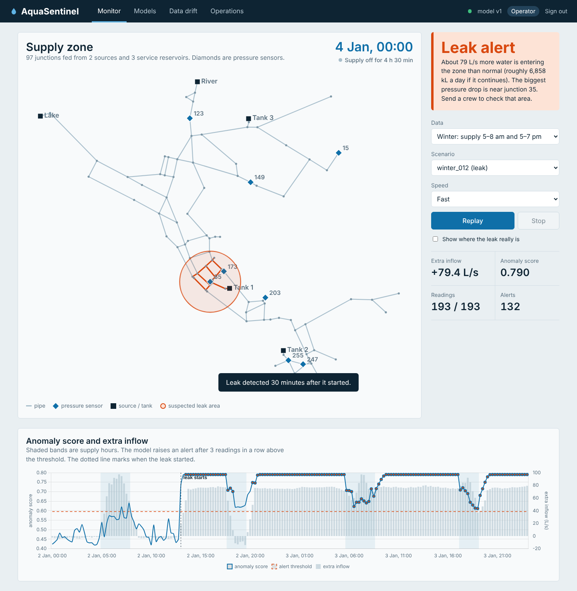

# AquaSentinel 💧
### Leak detection for water pipelines, with a complete MLOps / AIOps pipeline

B.Tech III Year (CSE) project for the course **AIOps & MLOps**.

AquaSentinel watches pressure and flow sensors in a city water supply zone and raises an
alert when the readings look like a leak. It is built for **intermittent supply**, the way
most Indian cities deliver water: the zone valve opens for a few hours a day, households fill
their storage tanks, supply timings slip, and power cuts leave gaps in sensor data.

Around the model it has the full MLOps lifecycle: data versioning, experiment tracking, a model
registry, an API with a web control room, monitoring, drift detection, automatic retraining,
automatic rollback and role-based access.



---

## 1. Why intermittent supply changes the problem

Most leak-detection examples assume water flows 24 hours a day. In most Indian cities it doesn't:
many get water for only a few hours a day. That breaks the usual approach of comparing
each reading with "the same time yesterday":

* When the valve opens, households fill sumps and overhead tanks, so inflow jumps and varies a
  lot from day to day. A leak is easy to miss in this period.
* Supply rarely starts at the same minute every day, so clock time is a poor reference.
* When the valve is closed, almost no water should flow. **Any steady inflow then is a strong sign
  of a leak.** Indian utilities use the same idea when they check minimum flow while supply is off.

## 2. How the model works

1. **Water balance:** water going into the zone (2 sources + 3 service reservoirs) = water used + leaks.
2. **Supply phase instead of clock time:** for every phase step (valve open 0–15 min, open 15–30 min,
   ..., closed for 2 hours, ...) the model learns the normal inflow and how much it varies. The
   valve status comes from SCADA.
3. **z-score:** each reading becomes "how many standard deviations above normal for this phase",
   averaged over 15 min, 1 h and 3 h. This puts the noisy supply hours and the quiet off-supply
   hours on the same scale.
4. **Isolation Forest**, trained only on normal readings (no leak labels needed). An alert is raised
   after 3 unusual readings in a row (45 minutes), and only if inflow is *above* normal, because a
   leak can only add water.
5. **Where to look:** the pressure sensor with the largest unusual drop is shown as the suspected area,
   and the extra inflow is converted to kilolitres per day so the loss is easy to understand.

## 3. Data

Real sensor data from Indian utilities is not public, so the project **simulates** a supply zone
with [WNTR](https://github.com/USEPA/WNTR) (the US EPA's water network simulator, built on EPANET),
using the EPANET *Net3* network as the zone (97 junctions, 2 sources, 3 service reservoirs,
8 pressure sensors, 7 flow meters, one reading every 15 minutes).

| Feature of Indian supply | How it is simulated (`params.yaml`) |
|---|---|
| Water for a few hours a day | valve open 5–8 am and 5–7 pm |
| Supply timings slip | start time shifts by up to 45 minutes each day |
| Households fill tanks and sumps | demand is 3× normal when supply starts, falling to 1.6× |
| Different amounts each supply | ±15% per supply window |
| Power cuts at the sensors | 30% of scenarios have a 1–3 hour gap in the data, filled by the validation step |
| Summer rationing | summer data: one window (6–8 am) and 20% more demand |

* **Winter data** (`data/raw/sensor_data.csv`): 36 scenarios of 2 days, 24 with a leak of random size
  at a random junction. Readings after the leak starts are labelled `leak = 1`.
* **Summer data** (`data/raw/summer_data.csv`): 24 scenarios under rationing, used to show drift.

### Results (test scenarios the model never saw)

| Model | Data | ROC-AUC | F1 | Leaks detected | Typical delay | False alarms |
|---|---|---|---|---|---|---|
| v1 | winter (two supplies a day) | 0.981 | 0.939 | 7 of 7 | 90 min | 0.5% |
| v1 | summer rationing | 0.985 | 0.839 | all | 30 min | **17.5%** ❌ |
| v2 (retrained automatically) | summer rationing | 0.990 | 0.867 | 2 of 2 | 38 min | 0.5% |

The typical delay is longer in winter because a leak that starts during supply hours is often
only confirmed once the valve closes. When the city switches to summer rationing, the winter
model raises false alarms on about 1 in 6 normal readings, because its idea of "normal" no longer
matches the new timetable. The drift check sees the timetable change and retraining fixes it.

### Where this fits in India

It is meant for a zone that has a bulk flow meter on every inlet and a SCADA record of when the
supply valve opens and closes, such as the district metered areas (DMAs) being set up under
AMRUT 2.0. A zone that moves to 24×7 supply is handled by retraining, because the drift check
sees the timetable change. Limits are listed in sections 9 and 10.

## 4. Syllabus mapping

| Unit | Topic | Where |
|---|---|---|
| 1 | ML anomaly detection | `src/model.py` (Isolation Forest) |
| 1 | Log anomaly detection + Matplotlib | `ops/log_anomaly.py` |
| 1 | Restart failed services automatically | `ops/watchdog.py` |
| 2 | Automated pipeline with Airflow | `dags/aquasentinel_dags.py` |
| 2 | Data ingestion and validation | `src/data.py` (`ingest`, `validate`) |
| 2 | Feature store | `feature_repo/` (Feast) |
| 2 | Data and model versioning | `dvc.yaml` + `dvc.lock` (DVC), MLflow tracking and registry |
| 3 | Model served with FastAPI, tested with REST calls | `api/main.py`, `tests/test_api.py` |
| 3 | Docker | `Dockerfile`, `docker-compose.yml` |
| 3 | Model registry, canary and shadow rollout | `src/registry.py`, `api/models.py` |
| 4 | Accuracy and drift monitoring | `src/train.py`, `src/monitor.py` (Evidently) |
| 4 | Prometheus + Grafana | `monitoring/`, `/metrics` endpoint |
| 4 | Drift (sensors + supply timetable) triggers retraining | `src/monitor.py`, hourly Airflow DAG |
| 4 | CI/CD | `.github/workflows/ci.yml`: tests, DVC pipeline, image published to GitHub Packages |
| 5 | Capstone: monitoring, alerts, automatic rollback | watchdog compares the new model with the previous one |
| 5 | Role-based access and model lineage | `api/auth.py`, `models/lineage.jsonl` |

## 5. Project structure

```
aquasentinel/
├── main.py              start the website + API (python main.py)
├── commands.txt         every command in one place
├── params.yaml          all settings
├── dvc.yaml, dvc.lock   data + training pipeline (DVC)
├── src/
│   ├── config.py        paths and helpers
│   ├── data.py          intermittent-supply simulation, validation, ingestion, Feast table
│   ├── model.py         supply-phase features + LeakDetector (Isolation Forest)
│   ├── train.py         train, evaluate, register in MLflow, champion vs challenger
│   ├── registry.py      promote, rollback, lineage log
│   └── monitor.py       drift check (sensors + supply timetable) and automatic retraining
├── api/
│   ├── main.py          FastAPI app: predictions, models, monitoring, website data
│   ├── auth.py          API keys with 3 roles + audit log
│   └── models.py        loads champion, previous and challenger models; shadow and canary rollout
├── web/                 the control room website (HTML, CSS, JavaScript)
├── ops/                 watchdog (auto-restart, auto-rollback), log anomaly detector
├── dags/                Airflow DAGs
├── feature_repo/        Feast feature store
├── monitoring/          Prometheus config, alert rules, Grafana dashboard
├── tests/               23 tests
├── .github/workflows/   CI/CD: lint, tests, DVC pipeline, Docker image published to GitHub Packages
└── Dockerfile, docker-compose.yml
```

## 6. How to run

All commands are also in `commands.txt`.

**One time:**
```bash
python -m venv venv
venv\Scripts\activate              # Mac/Linux: source venv/bin/activate
pip install -r requirements-dev.txt
dvc repro                          # simulate data (about 2 minutes) and train the first model
```

**Every time:**
```bash
venv\Scripts\activate
python main.py
```
Open **http://localhost:8000** and sign in as Admin, Operator or Viewer.
The API documentation is at http://localhost:8000/docs.

**Optional:**
```bash
python -m ops.watchdog                                          # auto-rollback (keep it running)
mlflow ui --backend-store-uri sqlite:///mlflow.db --port 5000   # experiment tracking UI
python -m ops.log_anomaly --generate-demo                       # log anomaly chart in reports/
pytest -q                                                       # tests
```

**Docker:** the CI/CD pipeline publishes a ready image on every push to `main`:
```bash
docker pull ghcr.io/shikhar0305/aquasentinel:latest
docker compose up -d --build          # full stack: website, MLflow server, Prometheus, Grafana
docker compose run --rm trainer       # data + first model inside the stack
```
Website http://localhost:8000, MLflow http://localhost:5000, Prometheus http://localhost:9090, Grafana http://localhost:3000.

**Airflow** and **Feast** commands are in `commands.txt`.

### The MLOps pipeline

```
params.yaml ─► dvc repro ─► simulate ─► train ─► MLflow registry ─► models/production ─► API + website
                                          ▲                                                 │
                       retrain ◄── drift ◄┘◄── ingest new data ◄────── Prometheus /metrics ◄┘
                                                                         watchdog: restart / rollback
git push ─► GitHub Actions: lint ─► tests ─► dvc repro (quality gate) ─► Docker image ─► GitHub Packages
```

* `dvc repro` re-runs only the stages whose code, data or settings changed; `dvc.lock` records the exact
  data hashes, so every model can be traced back to its data. `dvc metrics show` and `dvc params diff`
  compare runs.
* To store the data itself outside Git, add a DVC remote (for example a Google Drive folder):
  `dvc remote add -d storage gdrive://<folder-id>` and `dvc push`.

## 7. Demo for the viva

1. **Leak detection.** Sign in as *Operator*. Keep *Winter*, keep the first scenario, press
   **Replay**. Shaded bands are supply hours. Watch the score: the leak is hard to see while
   households fill their tanks, and stands out as soon as the valve closes. The status turns into
   *Leak alert* with the loss in kL/day, and the map circles the suspected area.
2. **Drift and retraining.** Sign in as *Admin*, open **Models**, press **Check new data for drift**
   four times. Each press brings in 4 summer-rationing scenarios. The timetable change is found
   straight away, retraining waits for 16 scenarios, then v2 is trained and put into production.
   **Data drift** shows "supply timing" as the biggest change.
3. **Automatic rollback.** Start `python -m ops.watchdog` in a second terminal. In **Models**,
   promote version 1 (the winter model) by hand. Choose *Summer rationing* and the scenario
   **summer_002 (normal)**, press **Replay**. v1 raises false alarms; the API also scores the same
   readings with v2 in the background. After about 100 readings the watchdog sees that v1 flags
   far more than v2 and rolls back. The chart marks "model v2 takes over".
4. **Access control.** Sign in as *Viewer*: Replay is disabled and admin actions are hidden.
   Calling `/predict` with the viewer key returns `403`.
5. **Auto restart.** Run the watchdog with
   `python -m ops.watchdog --start-cmd "python main.py"` and
   `ENABLE_CHAOS=true`, then call `POST /admin/crash` with the admin key. It comes back in about 15 s.


## 8. Problems we ran into

* **Clock time didn't work for intermittent supply.** Comparing with "normal for 6:15 am" failed
  because supply starts at a different time each day. Using minutes since the valve opened or closed
  fixed it.
* **The supply hours drowned out the leak.** Inflow during tank filling varies by ±15%, far more
  than a small leak. Turning each reading into a z-score for its supply phase lets the quiet
  off-supply hours carry the signal.
* **Drift check missed summer rationing at first.** Pressure and flow distributions barely changed,
  because most readings are off-supply in both seasons. What changed was the timetable, so the drift
  check now watches the valve status and timing too.
* **"Too many alarms" can't tell a broken model from a real leak.** A real leak also causes many
  alarms. The watchdog now compares the new model with the previous one on the same readings: during
  a real leak both alarm, but a broken model alarms alone.
* **"Less water than normal" was flagged as a leak.** A leak can only add water, so readings below
  normal are never counted.
* **Power cuts left gaps in the data.** The validation step fills short gaps before training and
  before the website replays data.

## 9. Applicability to Indian cities

| Works well | Needs more work |
|---|---|
| Zones with bulk flow meters on every inlet and a SCADA log of valve times (DMAs under AMRUT 2.0) | Zones with no inlet meters: there is no water balance to check |
| Zones moving to 24×7 supply (after retraining) | Pipes that fully empty between supplies (WNTR cannot simulate this; mains are assumed to stay charged) |
| Seasonal timetable changes, handled by drift detection and retraining | Telling a leak from an illegal connection: both look like extra inflow |

## 10. Limitations

* The data is simulated on the EPANET Net3 network, not measured in an Indian city.
* One leak at a time, and leaks never stop by themselves.
* The suspected area is the nearest pressure sensor, not an exact pipe.
* Not covered from the syllabus: Kubernetes/Helm, blue-green deployment, LLM/RAG and serverless.
