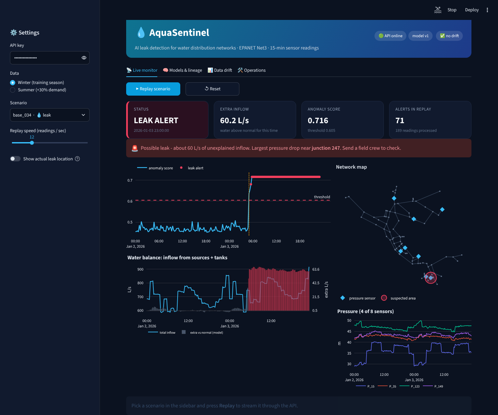

# AquaSentinel 💧
### AI-powered leak detection for water pipelines with an end-to-end MLOps / AIOps pipeline

B.Tech III Year (CSE) project for the course **AIOps & MLOps**.

AquaSentinel learns how a water network normally behaves from pressure and flow
sensors and raises an alert when the readings look like a leak. Around the model we built
the full lifecycle: data versioning, experiment tracking, model registry, API deployment,
monitoring, drift detection, automatic retraining, automatic rollback and access control.



---

## 1. Problem

Water utilities lose a large share of treated water through leaks in underground pipes.
Most leaks are found only when water comes to the surface. Utilities already measure
pressure and flow at some points of the network, so the idea is to use that data to
catch leaks early.

Real utility sensor data is not public, so we **simulate** a network with
[WNTR](https://github.com/USEPA/WNTR) (the EPA's Python wrapper around EPANET) and
inject leaks to get labelled data.

## 2. How the model works

* **Network:** EPANET example *Net3* (97 nodes, 119 links, 2 sources, 3 tanks, 2 pumps).
* **Sensors:** 8 pressure sensors (junctions) + 7 flow sensors (pipes), one reading every 15 min.
* **Data:** 36 scenarios of 2 days each (12 normal, 24 with one leak of a random size at a
  random junction). Noise is added to every sensor.
* **Key feature: the water balance.** Water going into the city (2 sources + 3 tanks) is
  equal to consumption + leaks. We compare total inflow with the normal inflow for the same
  15-minute slot of the day and smooth the difference over 15 min, 1 h and 3 h.
* **Model:** `IsolationForest` trained **only on normal readings** (no leak labels needed).
  The alarm threshold is the 98th percentile of anomaly scores on normal training data.
* **Alert rule:** a leak alert is raised only after 3 anomalous readings in a row (45 min),
  which removes one-off false alarms.
* **Root-cause hint:** the pressure sensor with the largest unusual drop is reported as
  the suspected area.

### Results (unseen test scenarios)

| Model | Data | Precision | Recall | F1 | ROC-AUC | Leaks detected | Median delay | False alarms |
|---|---|---|---|---|---|---|---|---|
| v1 | winter (training season) | 0.997 | 0.752 | 0.857 | 0.873 | 5 / 7 | 30 min | 0.0 % |
| v1 | summer (+30 % demand) | – | – | – | – | – | – | **98.5 %** ❌ |
| v2 (auto-retrained) | summer | 1.000 | 0.601 | 0.751 | 0.988 | 2 / 2 | 82 min | 0.0 % |

The two missed winter leaks were the smallest ones (< 15 L/s on a network using ~690 L/s).
The second row is why monitoring matters: the winter model flags almost every summer reading,
drift detection catches this, and retraining fixes it.

## 3. Architecture

```
            ┌──────────────┐   dvc repro    ┌───────────────┐
 params ──▶ │ WNTR         │ ─────────────▶ │ sensor_data   │──┐  (DVC tracked)
 .yaml      │ simulation   │                │ .csv          │  │
            └──────────────┘                └───────────────┘  │
                                                               ▼
 ┌──────────────┐  ingest/validate  ┌──────────┐  PSI drift   ┌──────────────┐  log params, metrics,
 │ new sensor   │ ────────────────▶ │ recent   │ ───────────▶ │ train.py     │  model ──▶ MLflow
 │ batches      │   (Airflow DAG)   │ data     │  (Evidently) │ IsolationForest│          registry
 └──────────────┘                   └──────────┘              └──────┬───────┘   champion/challenger
                                                                     │ promote if better
                                                                     ▼
 ┌──────────────┐  X-API-Key  ┌──────────────────┐ /metrics ┌────────────┐     ┌─────────┐
 │ Streamlit    │ ──────────▶ │ FastAPI (Docker) │ ───────▶ │ Prometheus │ ──▶ │ Grafana │
 │ dashboard    │             │ RBAC · shadow ·  │          │ alert rules│     └─────────┘
 └──────────────┘             │ canary · hot-reload          └────────────┘
                              └────────┬─────────┘
                                       │ /health, /model/info
                              ┌────────▼─────────┐
                              │ watchdog (AIOps) │  restart service · auto-rollback model
                              └──────────────────┘
```

## 4. Syllabus mapping

| Unit | Topic | Where in the project |
|---|---|---|
| 1 | Anomaly detection, AIOps lifecycle | `src/model.py` (Isolation Forest), `ops/log_anomaly.py` (ML on API logs + Matplotlib) |
| 1 | Auto-remediation (restart failed services) | `ops/watchdog.py` restarts the API after 3 failed health checks |
| 2 | Automated data pipelines (Airflow) | `dags/aquasentinel_dags.py`, `src/ingest.py` (validation + cleaning) |
| 2 | Feature store | `feature_repo/` (Feast: entity, feature view, offline + online retrieval) |
| 2 | Dataset and model versioning | `dvc.yaml` + `params.yaml` (DVC), MLflow tracking, data MD5 stored with each model |
| 3 | Serving with FastAPI | `api/main.py` (`/predict`, `/model/*`, `/metrics`) |
| 3 | Docker / orchestration | `Dockerfile`, `docker-compose.yml` (7 services) |
| 3 | Model registry and rollout strategies | MLflow aliases `champion` / `challenger`, `SHADOW_MODE`, `CANARY_PERCENT` in `api/model_service.py` |
| 4 | Accuracy and drift monitoring | `src/evaluate.py`, `src/drift.py` (Evidently, PSI) |
| 4 | Prometheus + Grafana | `monitoring/` (scrape config, 6 alert rules, provisioned dashboard) |
| 4 | Auto-retraining trigger and feedback loop | `src/retrain.py`, `aquasentinel_monitoring` DAG |
| 4 | CI/CD | `.github/workflows/ci.yml` (lint, tests, pipeline smoke test, Docker build) |
| 5 | Capstone: monitoring + anomaly detection + alerting + rollback | watchdog auto-rollback, Prometheus alerts, dashboard alerts |
| 5 | Role-based access control | `api/security.py` (admin / operator / viewer keys) + `logs/audit.log` |
| 5 | Model lineage | `models/lineage.jsonl`, MLflow version tags (data file, data MD5, git commit, metrics) |

## 5. Project structure

```
aquasentinel/
├── params.yaml              # every setting (simulation, sensors, model, drift, promotion)
├── dvc.yaml                 # simulate -> feature_table -> train
├── src/
│   ├── simulate.py          # WNTR simulation + leak injection
│   ├── features.py          # water balance + residual features
│   ├── model.py             # LeakDetector (scaler + IsolationForest + alert rule)
│   ├── evaluate.py          # ML metrics + detection rate / delay / false alarms
│   ├── train.py             # MLflow logging, registry, champion/challenger decision
│   ├── registry.py          # promote / rollback / lineage (CLI too)
│   ├── ingest.py            # batch ingestion + validation
│   ├── drift.py             # Evidently PSI drift check
│   ├── retrain.py           # ingest -> drift -> retrain cycle
│   └── feature_table.py     # builds the Feast feature table
├── api/                     # FastAPI app, model service, RBAC
├── dashboard/app.py         # Streamlit control room
├── ops/                     # watchdog (auto-restart, auto-rollback), log anomaly detector
├── dags/                    # Airflow DAGs
├── feature_repo/            # Feast feature store
├── monitoring/              # Prometheus, alert rules, Grafana
├── tests/                   # 22 pytest tests (data, features, model, drift, API, RBAC)
├── Dockerfile, docker-compose.yml, .github/workflows/ci.yml
```

## 6. Running it

### Option A – locally (quickest)

```bash
python -m venv venv && source venv/bin/activate        # Windows: venv\Scripts\activate
pip install -r requirements-dev.txt

# 1. data + first model  (or: git init && dvc init && dvc repro)
python -m src.simulate --mode train     # ~35 s
python -m src.simulate --mode drift     # summer data used later
python -m src.train

# 2. API under the watchdog, and the dashboard (two terminals)
ENABLE_CHAOS=true python -m ops.watchdog --start-cmd "uvicorn api.main:app --port 8000"
streamlit run dashboard/app.py

# 3. MLflow UI (optional)
mlflow ui --backend-store-uri sqlite:///mlflow.db
```

* API docs: http://localhost:8000/docs  · Dashboard: http://localhost:8501 · MLflow: http://localhost:5000

### Option B – full stack with Docker

```bash
cp .env.example .env            # change the keys
docker compose up -d --build
docker compose run --rm trainer # simulate data and train the first model
```

| Service | URL |
|---|---|
| API | http://localhost:8000/docs |
| Dashboard | http://localhost:8501 |
| MLflow | http://localhost:5000 |
| Prometheus | http://localhost:9090 |
| Grafana | http://localhost:3000 (admin / your password) |

Start the watchdog on the host to restart the container: `python -m ops.watchdog --restart-cmd "docker restart aquasentinel-api"`.

### Airflow

```bash
export AQUA_HOME=$(pwd)
export AIRFLOW__CORE__DAGS_FOLDER=$(pwd)/dags
airflow standalone            # then enable aquasentinel_training and aquasentinel_monitoring
```

### Feast feature store

```bash
pip install -r requirements-feast.txt
python -m src.feature_table
cd feature_repo && feast apply && feast materialize-incremental $(date -u +%Y-%m-%dT%H:%M:%S) && cd ..
python feature_repo/demo_feast.py
```

### Tests

```bash
pytest -q        # 22 tests, ~15 s (runs a small real WNTR simulation)
flake8 .
```

## 7. Demo script (for the viva)

1. **Leak detection:** dashboard → Winter data → the default leak scenario → *Replay*. The
   score jumps above the threshold soon after the leak starts and the alert banner names the
   suspected area. Turn on *Show actual leak location* to compare with the truth.
2. **Drift + retraining:** run `python -m src.retrain` four times. Each run ingests 4 summer
   scenarios. Drift is detected from the first batch, retraining waits until 16 scenarios
   have arrived, then v2 is trained and promoted because v1 raises 98 % false alarms. The API
   loads v2 by itself. See the *Models & lineage* and *Data drift* tabs.
3. **Automatic rollback:** promote the old model by hand
   (`curl -X POST localhost:8000/model/promote/1 -H "X-API-Key: admin-dev-key"`) and replay a
   summer scenario. After about 100 readings the watchdog sees that almost everything is flagged
   and rolls back to v2 (*Operations* tab, `logs/incidents.jsonl`).
4. **Auto restart:** `curl -X POST localhost:8000/admin/crash -H "X-API-Key: admin-dev-key"`
   kills the API; the watchdog restarts it within ~15 s.
5. **RBAC:** call `/predict` with the viewer key → `403`; without a key → `401`.
6. **Log anomalies:** `python -m ops.log_anomaly --generate-demo` → `reports/log_anomalies.png`.

## 8. API quick reference

| Method | Path | Role | What it does |
|---|---|---|---|
| GET | `/health` | – | status + loaded model version |
| POST | `/predict` | operator | score readings (send the last ≥ 12 readings) |
| GET | `/model/info` | viewer | champion, challenger, recent anomaly rate |
| GET | `/model/lineage` | viewer | full lineage log |
| GET | `/monitoring/drift` | viewer | last drift check |
| POST | `/model/reload` | admin | reload from disk |
| POST | `/model/promote/{v}` | admin | make version *v* the champion |
| POST | `/model/rollback` | admin | go back to the previous champion |
| GET | `/metrics` | – | Prometheus metrics |

```bash
curl -X POST localhost:8000/predict -H "X-API-Key: operator-dev-key" \
     -H "Content-Type: application/json" \
     -d '{"readings":[{"timestamp":"2026-01-02T06:00:00","sensors":{"P_15":27.5, "...":0}}]}'
```

## 9. Problems we ran into (and what we changed)

* **False alarms on the first day.** The tanks in Net3 start at fixed levels and take about a
  day to settle, so every scenario looked strange at the start. We now drop the first 24 h as
  warm-up.
* **Pressure features hurt in summer.** Our first model used all 8 pressure residuals. In the
  summer data the tank levels swing more, pressures got noisy and the model's F1 dropped
  below 0.2. Using only the water balance worked much better in both seasons, so pressure is
  now used only for the "suspected area" hint.
* **K-S drift test was too sensitive.** With thousands of time-correlated readings, Evidently's
  default K-S test said almost every column drifted even for normal data. We switched to PSI
  with a limit of 0.5 (on our data, normal test days stay below 0.40 and every summer column is above 0.62).
* **F1 picked a broken model.** In summer, leaks make up about 37 % of the readings, so a
  model that flags everything still gets F1 ≈ 0.64 and looked better than the retrained model.
  Promotion now uses ROC-AUC, and any model with more than 5 % false alarms scores 0.

## 10. Limitations / future work

* Data is simulated. Real SCADA data would have missing values, sensor faults and pump
  schedules that change over the year.
* Only one leak at a time, and the leak never stops by itself.
* The suspected area is the nearest pressure sensor, not an exact location. A proper
  localisation model (e.g. a classifier over network zones) would be the next step.
* Leak labels for retraining are assumed to come from repair tickets (the feedback loop);
  in practice they arrive late and are incomplete.
* Stretch goal from Unit 5 not done: an LLM assistant (RAG over incident logs and
  maintenance manuals) that explains alerts to operators.
