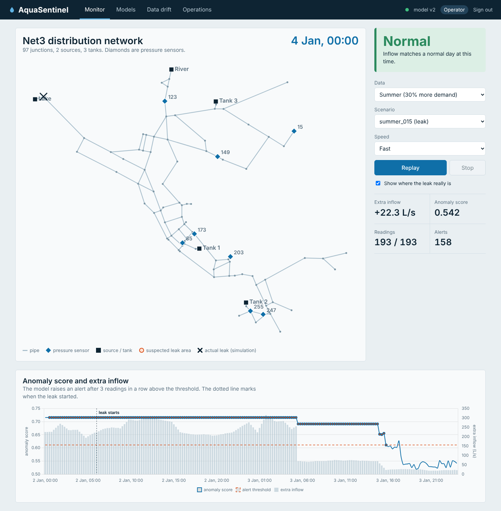

# AquaSentinel 💧
### Leak detection for water pipelines, with a complete MLOps / AIOps pipeline

B.Tech III Year (CSE) project for the course **AIOps & MLOps**.

AquaSentinel watches pressure and flow sensors in a water network and raises an alert
when the readings look like a leak. Around the model it has the full lifecycle: data
versioning, experiment tracking, a model registry, an API with a web control room,
monitoring, drift detection, automatic retraining, automatic rollback and role-based access.


---

## 1. The idea in three sentences

1. Water going into the city (from 2 sources and 3 tanks) = water people use + water leaking.
2. We know how much water is normally used at each time of day, so **extra inflow** is suspicious.
3. An **Isolation Forest** learns what normal extra inflow looks like and raises an alert when
   readings stay unusual for 45 minutes.

## 2. Data

Real sensor data from water utilities is not public, so the project **simulates** it with
[WNTR](https://github.com/USEPA/WNTR) (the US EPA's water network simulator, built on EPANET).

* **Network:** EPANET *Net3* (97 junctions, 119 pipes, 2 sources, 3 tanks).
* **Sensors:** 8 pressure sensors + 7 flow sensors, one reading every 15 minutes.
* **Winter data** (`data/raw/sensor_data.csv`): 36 scenarios of 2 days, 24 of them with a leak
  of random size at a random junction. Readings after the leak starts are labelled `leak = 1`.
* **Summer data** (`data/raw/summer_data.csv`): 24 scenarios with 30% higher demand, used to
  show drift and retraining.

All settings (number of scenarios, leak sizes, noise) are in `params.yaml`.

## 3. Results (test scenarios the model never saw)

| Model | Data | ROC-AUC | F1 | Leaks detected | Typical delay | False alarms |
|---|---|---|---|---|---|---|
| v1 | winter | 0.873 | 0.856 | 5 of 7 | 45 min | 0% |
| v1 | summer | – | – | – | – | flags almost every reading ❌ |
| v2 (retrained automatically) | summer | 0.988 | 0.749 | 2 of 2 | 83 min | 0% |

The two missed winter leaks were the smallest (about 2 and 13 L/s, on a network using about
690 L/s). The second row is why monitoring matters: drift detection notices the change and
retraining fixes it.

## 4. Syllabus mapping

| Unit | Topic | Where |
|---|---|---|
| 1 | ML anomaly detection | `src/model.py` (Isolation Forest) |
| 1 | Log anomaly detection + Matplotlib | `ops/log_anomaly.py` |
| 1 | Restart failed services automatically | `ops/watchdog.py` |
| 2 | Automated pipeline with Airflow | `dags/aquasentinel_dags.py` |
| 2 | Data ingestion and validation | `src/data.py` (`ingest`, `validate`) |
| 2 | Feature store | `feature_repo/` (Feast) |
| 2 | Data and model versioning | `dvc.yaml` (DVC), MLflow tracking |
| 3 | Model served with FastAPI, tested with REST calls | `api/main.py`, `tests/test_api.py` |
| 3 | Docker | `Dockerfile`, `docker-compose.yml` |
| 3 | Model registry, canary and shadow rollout | `src/registry.py`, `api/models.py` |
| 4 | Accuracy and drift monitoring | `src/train.py`, `src/monitor.py` (Evidently) |
| 4 | Prometheus + Grafana | `monitoring/`, `/metrics` endpoint |
| 4 | Drift triggers retraining | `src/monitor.py`, hourly Airflow DAG |
| 4 | CI/CD | `.github/workflows/ci.yml` (GitHub Actions) |
| 5 | Capstone: monitoring, alerts, automatic rollback | watchdog + website + Prometheus alerts |
| 5 | Role-based access and model lineage | `api/auth.py`, `models/lineage.jsonl` |

## 5. Project structure

```
aquasentinel/
├── params.yaml          all settings
├── src/
│   ├── config.py        paths and helpers
│   ├── data.py          simulation, validation, ingestion, Feast table
│   ├── model.py         features + LeakDetector (Isolation Forest)
│   ├── train.py         train, evaluate, register in MLflow, champion vs challenger
│   ├── registry.py      promote, rollback, lineage log
│   └── monitor.py       drift check (Evidently) and automatic retraining
├── api/
│   ├── main.py          FastAPI app: predictions, models, monitoring, website data
│   ├── auth.py          API keys with 3 roles + audit log
│   └── models.py        loads champion/challenger, shadow and canary rollout
├── web/                 the control room website (HTML, CSS, JavaScript)
├── ops/                 watchdog (auto-restart, auto-rollback), log anomaly detector
├── dags/                Airflow DAGs
├── feature_repo/        Feast feature store
├── monitoring/          Prometheus config, alert rules, Grafana dashboard
├── tests/               20 tests
└── Dockerfile, docker-compose.yml, dvc.yaml, .github/workflows/ci.yml
```

## 6. How to run (VS Code / terminal)

**One time:**
```bash
python -m venv venv
venv\Scripts\activate              # Mac/Linux: source venv/bin/activate
pip install -r requirements-dev.txt
python -m src.data simulate        # about 1 minute
python -m src.train
```

**Every time:**
```bash
venv\Scripts\activate
python -m uvicorn api.main:app --port 8000
```
Open **http://localhost:8000** and sign in as Admin, Operator or Viewer.
The API documentation is at http://localhost:8000/docs.

**Optional:**
```bash
python -m ops.watchdog                                      # auto-rollback (keep running in another terminal)
mlflow ui --backend-store-uri sqlite:///mlflow.db --port 5000   # experiment tracking UI
python -m ops.log_anomaly --generate-demo                   # log anomaly chart in reports/
pytest -q                                                   # tests
dvc repro                                                   # rebuild data + model with DVC (after git init, dvc init)
```

**Full stack with Docker** (adds the MLflow server, Prometheus and Grafana):
```bash
docker compose up -d --build
docker compose run --rm trainer
```
Website http://localhost:8000 · MLflow http://localhost:5000 · Prometheus http://localhost:9090 · Grafana http://localhost:3000

**Airflow:** `export AQUA_HOME=$(pwd)`, point `dags_folder` to `dags/`, run `airflow standalone`.
**Feast:** `pip install -r requirements-feast.txt`, `python -m src.data features`,
then `cd feature_repo && feast apply && feast materialize-incremental <now>`, and run `python feature_repo/demo_feast.py`.

## 7. Demo for the viva

1. **Leak detection.** Sign in as *Operator*. Keep *Winter*, keep the first scenario, press
   **Replay**. The score jumps over the threshold after the leak starts, the status turns into
   *Leak alert*, and the map circles the suspected area. Tick *Show where the leak really is*.
2. **Drift and retraining.** Sign in as *Admin*, open **Models**, press **Check new data for drift**
   four times. Each press brings in 4 summer scenarios. Drift is found straight away, retraining
   waits for 16 scenarios, then v2 is trained and put into production. See **Data drift**.
3. **Automatic rollback.** Start `python -m ops.watchdog` in a second terminal. In **Models**,
   promote version 1 (the winter model) by hand, then replay a *Summer* scenario. After about
   100 readings the watchdog sees that almost everything is flagged and rolls back to v2.
   **Operations** shows the incident.
4. **Access control.** Sign in as *Viewer*: the Replay button is disabled and admin actions are
   hidden. Calling `/predict` with the viewer key returns `403`.
5. **Auto restart.** Run the watchdog with
   `python -m ops.watchdog --start-cmd "python -m uvicorn api.main:app --port 8000"` and
   `ENABLE_CHAOS=true`, then call `POST /admin/crash` with the admin key. It comes back in about 15 s.



## 8. Problems we ran into

* **False alarms on day one.** The tanks start at fixed levels and need about a day to settle,
  so the first day is dropped.
* **Pressure features hurt in summer.** The first model used all 8 pressure sensors. In summer
  the tank levels swing more and the model got much worse (F1 below 0.2), so the model now uses
  only the water balance. Pressure is used to suggest *where* the leak is.
* **"Less water than normal" was flagged as a leak.** Isolation Forest flags both directions.
  A leak can only add water, so readings below normal are never counted as leaks.
* **The default drift test was too sensitive.** Evidently's K-S test flagged nearly every sensor
  even on normal data, so we use PSI with a limit of 0.5.
* **F1 picked a broken model.** In summer a model that flags everything still gets a decent F1,
  so promotion uses ROC-AUC and rejects any model with more than 5% false alarms.

## 9. Limitations

* The data is simulated; real SCADA data has gaps, sensor faults and changing pump schedules.
* One leak at a time, and leaks never stop by themselves.
* The suspected area is the nearest pressure sensor, not an exact pipe.
* Not covered from the syllabus: Kubernetes/Helm, blue-green deployment, LLM/RAG and serverless.
